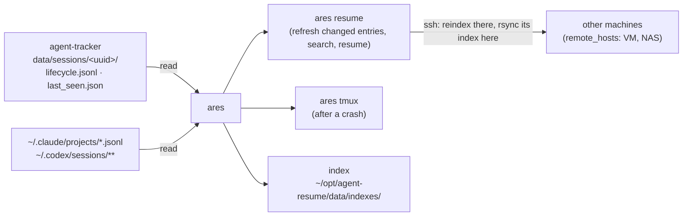

# agent-resume (`ares`): find and resume agent sessions

**A CLI tool that extends Claude Code's (and Codex CLI's) session management with full-text search across folders and machines (a session resumes on its own machine), and a crash restore of the whole tmux setup - one unified picker across both agents.** Formerly agent-session-manager (`asm`, renamed 2026-11-07); `asm` stays as an alias of `ares` for a while.



## What Claude Code / Codex Provide Natively

Claude Code has built-in session discovery via `/resume` (inside a session) and `claude --resume` (from the CLI). Codex CLI has the equivalent `codex resume`/`codex resume --last`. Both open an interactive picker showing sessions with titles, timestamps, and message counts.

Since 2026 (Claude Code v2.1.1xx-2.1.3xx; no changelog line), `claude --resume <uuid>` finds a session from any folder, as `codex resume <uuid>` always did. What is still missing:

- No search by content: the pickers show titles; Claude's `/resume` shows the current folder first (`Ctrl+A` for all projects)
- Each agent's picker only shows that agent's own sessions
- You cannot see sessions from another machine at all

## What ares Adds

ares solves problems that Claude Code's native resume does not address.

### 1. Cross-Directory Session Discovery

ares indexes **all** local sessions across **all** project directories into a single searchable catalog, searched by the words of the whole conversation. You search once, from anywhere, and ares resumes the session in the last folder it ran in (the current folder if that one no longer exists).

**Full-text keyword search** across the entire conversation content (not just titles). Strict matching first, automatic fuzzy fallback if no exact matches. Filter by hostname, date range, or both.

### 2. Sessions of Other Machines (optional)

List the other machines in `remote_hosts` (`~/opt/agent-resume/data/settings.json`, their ssh names, e.g. `["H-Frank-1", "babisnas"]`). Then each `ares resume`, at the same time as it refreshes this machine's index:

- runs `ares reindex` on each of them over ssh (~0.4 s), then copies its index here with `rsync`, one way, into `~/opt/agent-resume/data/remote/<host>/` (read-only copies; their non-interactive entries left out);
- searches them with this machine's sessions, in one picker;
- resumes a session of another machine **there**: `ssh -t <host> 'cd <last folder> && claude --resume <uuid>'`. Transcripts never move: a project is worked on in its home machine only.

A machine out of reach (the NAS away from home) costs 3 s (`ConnectTimeout`) and a one-line warning; its sessions stay listed from the last copy. No sync, no hub, no scheduled job, no conflict to resolve (until 2026-11-20 an index-only sync, `ares-sync`, did that; it was never configured on any machine).

### 3. One Picker Across Claude Code and Codex CLI

If you use both agents, `ares resume` indexes and searches both into the same catalog - not two separate tools. Each row is tagged `[claude]` or `[codex]` (colored so they're distinguishable at a glance), and `--agent claude`/`--agent codex` filters to one. Resuming dispatches to the right native command under the hood (`claude --resume <uuid>` vs `codex resume <uuid>`; `/rename` on resume becomes a `claude --resume ... '/rename ...'` fork vs `codex fork <uuid>`), so this isn't a reimplementation of either agent's resume mechanics, just a unified front end over both. Codex support auto-detects (enabled automatically if `~/.codex/sessions` exists) and is fully additive - a Claude-only setup sees no behavior change.

Not every feature has full parity yet - see [Feature Support by Agent](#feature-support-by-agent) below.

### 4. Crash Restore of the Whole tmux Setup (`ares tmux`)

After a crash (or a reboot), `ares tmux` puts back what was open at the end of the previous boot, as agent-tracker's **snapshot** recorded it (since 2026-11-17): every tmux session, window (index, name, exact pane sizes via the saved `window_layout`) and pane, `claude --resume <uuid>` in each pane where Claude was still running, a shell in its own folder in the others, then the iTerm2 windows (position and size) with their tabs in the same order. It reads only agent-tracker's files.

```text
agent-tracker's files                                  ares tmux
data/snapshots/<boot_ts>.tsv  (≤ 1 min old)   ──►  every tmux pane, its folder, its command; iTerm2 windows and tabs
data/sessions/<uuid>/lifecycle.jsonl          ──►  Claude sessions killed in that boot (no clean exit)
                     last_seen.json           ──►  matched to their pane by pane_id
                                              ──►  tmux new-session / new-window / split-window, select-layout,
                                                   send-keys "cd <folder> && claude --resume <uuid>"
                                              ──►  iTerm2: each window at its bounds, its tabs in order (AppleScript)
```

A tmux session that already exists is never touched (printed as skipped, with its `claude --resume` commands to run by hand). A previous boot without a snapshot (before 2026-11-17, or no Claude session ran) falls back to the old guess from `last_seen.json`: only windows that held a Claude session, plain shells in `~`, "stale" Claude sessions (last seen > 2 min before the others) only with `--all`, one iTerm2 window.

### 5. Session Analytics

The JSON index stores structured metadata for every session: conversation messages with timestamps, hostname, working directory, tmux place and session state (from agent-tracker's lifecycle), and titles, queryable with `jq`.

## Key Features

| Feature | Native `/resume` | ares |
|---|---|---|
| Interactive picker | ✅ Yes (built-in) | ✅ Yes (fzf) |
| Search by title | ✅ Yes (picker filter) | ✅ Yes |
| Search by conversation content | ❌ No | ✅ Yes (full-text keyword search) |
| See sessions from other directories | ✅ `Ctrl+A` in `/resume` | ✅ Yes |
| Resume from a different directory | ✅ Yes (`claude --resume <uuid>`, 2026) | ✅ Yes (in the last folder it ran in) |
| See and resume sessions of other machines | ❌ No | ✅ Yes (`remote_hosts`, resumed there over ssh) |
| Unified picker across Claude Code + Codex CLI | ❌ No (each agent only sees its own) | ✅ Yes |
| LLM-generated titles | ✅ Yes (native `ai-title`) | ✅ Yes (reads the same native `ai-title`, plus `/rename`) |
| Hostname/date filtering | ❌ No | ✅ Yes |
| Session state tracking | ❌ No | ✅ Yes (pending/exited, from agent-tracker) |
| Crash restore of tmux + Claude sessions | ❌ No | ✅ Yes (`ares tmux`) |
| Prompt/character analytics | ❌ No | ✅ Yes (full conversation stored in JSON index) |
| Fuzzy search fallback | ❌ No | ✅ Yes |

## Feature Support by Agent

| Feature | Claude Code | Codex CLI |
|---|:---:|:---:|
| Reindex, search, unified picker | ✅ | ✅ |
| True resume | ✅ `claude --resume` | ✅ `codex resume` |
| Fork (`/rename` on resume) | ✅ | ✅ `codex fork` |
| Other machines (`remote_hosts`) | ✅ | ✅ |
| Session state (from agent-tracker) | ✅ | ✅ if agent-tracker records Codex |
| Duplicate-session warning (SessionStart) | ✅ native hook | ✅ via a `codex plugin` (one-time hook-trust approval on first use) |
| `ares tmux` (crash restore) | ✅ | ❌ (Claude sessions only) |

## How It Works

```
 this machine                                                    each remote host (remote_hosts)
 ~/.claude/projects/**/*.jsonl, ~/.codex/sessions/**             the same, and its own ~/opt/agent-resume
 agent-tracker's lifecycle.jsonl                                        │
        │ refresh (only what changed)                     ssh: ares reindex there
        ▼                                                               ▼
 data/indexes/*.json  ◄──── one picker ────►  data/remote/<host>/*.json  ◄── rsync (one way, at each search)
        │                     (fzf)                                     │
        ▼                                                               ▼
 cd <last folder> && claude --resume <uuid>          ssh -t <host> 'cd <last folder> && claude --resume <uuid>'
```

Codex sessions (`~/.codex/sessions/**/*.jsonl`) feed into the same index alongside Claude Code's, tagged `agent_type: "codex"`, and resume with `codex resume`.

Everything is local-first: `ares reindex` never touches the network, and `ares resume` does only for the `remote_hosts`.

### agent-tracker's files, and the hook

The facts a transcript lacks (host, tmux pane, start and end) come from agent-tracker (`~/opt/agent-tracker/data/sessions/<uuid>/`), its only writer: `lifecycle.jsonl` (one line per start and end) and `last_seen.json` (where the Claude session runs, rewritten by the statusline). agent-resume reads them; it records nothing itself.

Its one hook, for Claude Code and (through the Codex plugin) Codex: `session_start.py` (SessionStart) warns when the session you start is already running in another live process (an earlier start line of this machine and boot whose pid is alive with the same start time): an orange banner on the terminal for 3 s (Ctrl+C aborts) and the warning in the agent's context. Otherwise it prints nothing. (Its "other machine" and "other folder" warnings, and the SessionEnd hook that re-indexed and pushed, were removed on 2026-11-20.)

## Usage

### `ares resume` - find and resume a past session

```bash
ares resume                          # browse recent sessions, no keywords
ares resume profiling hallucination  # full-text keyword search (fuzzy fallback if no exact match)

# Filters
ares resume --host myserver          # only sessions from a given hostname
ares resume --agent codex            # only claude or only codex sessions
ares resume --state pending          # pending (a start in agent-tracker's lifecycle with no end yet) or exited
ares resume --tmux mywork            # only sessions started in tmux session "mywork"
ares resume -f 30                    # only active in the last 30 days (default: 90)
ares resume -u 7                     # only active more than 7 days ago
ares resume --max-scan 200           # recent sessions scanned when no keywords given (default: 50)

# Resume behavior
ares resume --fork                   # fork into a new session instead of resuming in place (claude --resume ... /rename, or codex fork)
ares resume --print-cmd              # print the resolved resume/fork command instead of executing it
ares resume -v                       # verbose logging (timestamps on stderr)
```

Each row is tagged `[claude]` or `[codex]`; resuming or forking automatically runs the right agent's native command for that session.

Each row shows the machine the session lives on, in **blue** when that's this
machine and **dark red** when it's another one (resumed there, over ssh). Sessions
with no lifecycle line (older ones) have no recorded hostname; they're attributed
to the machine that indexed them, since `.jsonl` transcripts never move between machines.

A session resumes in the last folder it ran in (agent-tracker's newest start), or in the current folder when that one no longer exists: `claude --resume <uuid>` finds its transcript from any folder. A session whose transcript is gone from this machine (`[Deleted]`) cannot be resumed; its conversation stays in the index.

The last column, in grey, is the first 8 characters of the session's UUID, followed by `...` (e.g. `3f2a91c0...`).

Before searching, `ares resume` re-indexes only the transcripts (and lifecycles) newer than their index entry: ~50 ms of dates for 3,111 transcripts plus the few that changed (measured 2026-11-07), so the picker never lags behind a running Claude session.

Sessions nobody typed in are never listed: `claude -p` and Agent SDK runs, Codex sub-agents and `codex exec`. They stay in the index, so `ares resume --uuid <uuid>` still opens one.

### `ares reindex` - rebuild the local JSON index

```bash
ares reindex                # incremental: only sessions changed since the last index
ares reindex -n 5           # cap at 5 sessions this run
ares reindex --force        # reindex everything + retry title generation on orphaned entries
ares reindex --uuid <uuid>  # reindex a single session
```

### `ares tmux` - after a crash, restore the previous boot's tmux setup

```bash
ares tmux --dry-run          # print the plan: tmux sessions, windows, panes, the claude --resume per pane, the iTerm2 windows
ares tmux                    # do it, then open the iTerm2 windows and tabs as they were
ares tmux --all              # no snapshot of that boot only: also the stale Claude sessions
ares tmux --this-boot        # the tmux server died WITHOUT a reboot: this boot's Claude sessions whose process is gone
                             # without a clean exit (Claude Code logs such a death as SessionEnd reason "other")
ares tmux --no-iterm         # no iTerm2 tab (attach yourself: tmux attach -t =<name>)
```

### Other

```bash
ares --version   # show version
ares --help      # show all flags
asm ...          # the same as ares (alias, kept for a while after the rename)
```

## Installation

```bash
git clone <repo-url> agent-resume
bash agent-resume/install.sh
```

Requires `fzf` and `python3`, and agent-tracker for the session state, the duplicate warning and `ares tmux`; `ssh` and `rsync` for the `remote_hosts`. `install.sh` is idempotent, and self-migrating: it removes what the version before 2026-11-20 installed (the 30-min job, the SessionEnd hook, `ares-sync`, the skill `inject-session`). `uninstall.sh` removes everything but `~/opt/agent-resume/data/`. On the VM and the NAS: `bash tools/deploy_remote.sh` from the Mac's checkout (a git bundle over ssh, no GitHub needed).

| Artifact | Destination |
|---|---|
| `ares` | `~/opt/agent-resume/bin/`, linked from `~/.local/bin/` as `ares` and the alias `asm` |
| `session_start.py` (the hook), `codex-plugin/` + `codex-marketplace/`, `install.sh`, `uninstall.sh` | `~/opt/agent-resume/` |
| settings, index, copies of other machines' indexes | `~/opt/agent-resume/data/{settings.json,indexes/,remote/<host>/}` |
| the SessionStart hook group | `~/.claude/settings.json` (install.sh replaces only its own group) |
| the same hook for Codex, if detected | plugin `agent-resume@agent-resume-local` in `~/.codex/config.toml` (`codex plugin marketplace add` / `codex plugin add`, idempotent); Codex asks once to trust its hooks |

## Settings (`~/opt/agent-resume/data/settings.json`)

Created by `install.sh` on first install, never overwritten afterward. All keys are optional.

| Key | Default | Purpose |
|---|---|---|
| `local_projects_dir` | `~/.claude/projects` | Where Claude Code writes session files locally |
| `local_index_dir` | `~/opt/agent-resume/data/indexes` | Where `ares reindex` writes the JSON index locally |
| `ignore_path_substrings` | `[]` | List of substrings; any `.jsonl` whose path contains one is skipped entirely during reindex. Use this to exclude sessions from a specific tool, bot, or scratch directory (e.g. `["/agent-scratch/"]`) without a code change. |
| `remote_hosts` | `[]` | ssh names of the other machines whose sessions `ares resume` also shows, and resumes there (the Mac: `["H-Frank-1", "babisnas"]`). Each needs agent-resume installed in `~/opt/agent-resume`. |
| `codex_sessions_dir` | `~/.codex/sessions` | Where Codex CLI writes session files locally |
| `codex_session_index_file` | `~/.codex/session_index.jsonl` | Codex's own title index (Codex stores titles separately from the transcript, unlike Claude Code) |
| `codex_enabled` | `null` | `null` = auto-detect (enabled iff `codex_sessions_dir` exists); set `true`/`false` to force it either way |

## Important: Extend Session Retention

Claude Code **deletes session `.jsonl` files after 30 days by default**. Once deleted, sessions can no longer be resumed (ares will show them as `[Deleted]` in the picker). To prevent this, add to `~/.claude/settings.json` on **every machine**:

```json
{
  "cleanupPeriodDays": 365
}
```

This must be set on each machine independently. (Codex CLI's own session-retention behavior hasn't been investigated - if it also prunes old sessions, an equivalent setting may exist in its own config.)

## Technical Details

- Pure Python (stdlib only, no pip dependencies) for `ares` and its hook; no daemon, no scheduled job
- Parallel reindexing with 10 concurrent workers
- Incremental: skips sessions unchanged since last index (mtime comparison)
- Titles come from `/rename` (custom) or Claude Code's own native `ai-title` - no separate title-generation plugin needed
- Atomic file writes (tempfile + os.replace) for crash safety
- JSON index format, queryable with `jq` for ad hoc analysis
- Resume search completes in well under a second from local disk

## Several Claude accounts (2026-11-19)

`claude` is my-setup's account selector on every machine (`~/.local/bin/claude`, since 2026-11-20), so `ares resume` and `ares tmux` just run `claude --resume <uuid>`: the selector appears before the session opens, preselecting the session's last account. Over ssh, `ares resume` puts `~/.local/bin` on the remote `PATH` first (a non-interactive ssh shell may not have it).
