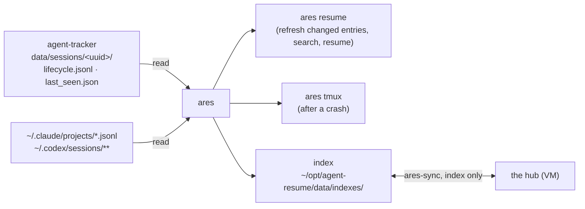

# agent-resume (`ares`): find and resume agent sessions

**A CLI tool that extends Claude Code's (and Codex CLI's) session management with cross-directory search, cross-machine sync and a crash restore of the whole tmux setup - one unified picker across both agents.** Formerly agent-session-manager (`asm`, renamed 2026-11-07); `asm` stays as an alias of `ares` for a while.



## What Claude Code / Codex Provide Natively

Claude Code has built-in session discovery via `/resume` (inside a session) and `claude --resume` (from the CLI). Codex CLI has the equivalent `codex resume`/`codex resume --last`. Both open an interactive picker showing sessions with titles, timestamps, and message counts.

However, both are **scoped to the current project directory** (the slug derived from your working directory), and each agent's picker only shows that agent's own sessions. This means:

- You can only see sessions started in the folder you are currently in
- You cannot search or resume sessions from a different folder, even on the same machine
- You cannot see sessions from another machine at all
- If you `cd` to a different directory and run `claude --resume`, your previous sessions are invisible

## What ares Adds

ares solves problems that Claude Code's native resume does not address.

### 1. Cross-Directory Session Discovery

Claude Code's `/resume` is blind to sessions outside the current directory. If you ran sessions across 20 different project folders over the past month, you would need to `cd` into each one individually and check `/resume` to find the one you are looking for.

ares indexes **all** local sessions across **all** project directories into a single searchable catalog. You search once, from anywhere, and ares handles the `cd` for you before resuming.

**Full-text keyword search** across the entire conversation content (not just titles). Strict matching first, automatic fuzzy fallback if no exact matches. Filter by hostname, date range, or both.

### 2. Cross-Machine Visibility (optional, index-only)

ares is **local-first**: everything it writes lives on local disk, and it works fully offline with no remote configured. If you also work from a second machine (a personal VM, a devserver, another laptop) with no shared filesystem between them, `ares-sync` optionally syncs the **index only** over plain SSH - no mounted drive, no cloud-storage folder, and never the raw session transcripts.

- Configure a remote host once in `~/opt/agent-resume/data/settings.json` (`remote_ssh_host`, `remote_ssh_user`, `remote_ssh_port`, `remote_index_dir`).
- **Hub and spoke, not mesh.** Point every machine's `remote_ssh_host` at whichever one is reliably reachable (a VM with a public IP, typically - not a laptop behind home NAT). That machine (the hub) leaves its own `remote_ssh_host` empty; it never needs to dial out. Every other machine (a spoke) pushes and pulls to the hub.
- Three independent triggers keep the index fresh: (1) the `SessionEnd` hook (`session_end.sh`) reindexes and pushes the session that just ended, in the background; (2) `ares resume` opportunistically pulls before searching (rate-limited, hard-capped at a few seconds, never blocks or crashes if you're offline); (3) a scheduled job (`launchd`/`systemd`, every 30 min) reindexes then syncs both directions.
- **Offline-resilient by design**, not by accident: every sync attempt is logged to `~/opt/agent-resume/data/sync-log.jsonl`. `ares resume` reads it and prints a one-line warning if the last successful sync is stale or missing - instead of either crashing when you're offline (a laptop won't always have internet) or silently searching data that's quietly out of date.
- If no remote is configured, `ares-sync` exits silently. Nothing about local indexing or resume depends on it.

**Why index-only:** the JSON index already embeds the full conversation - every message, role, timestamp, not a summary. Nothing needed for search or `/inject-session` is lost by never transferring the raw `.jsonl`. This also means index files never need conflict resolution (they're always fully regenerated by `ares reindex`, so newest-`mtime`-wins is enough) - unlike raw append-only transcripts, which is why an earlier version of this tool that also synced `.jsonl` needed much more machinery here.

**What sync does *not* give you**: a shared filesystem. Claude Code derives its project-folder slug from the absolute working directory path, and a session started on one machine will almost never have a matching directory on the other (different absolute paths entirely, e.g. a laptop `/Users/...` project vs a VM `/home/...` project). So a session synced from another machine cannot be **truly resumed** in place - `ares resume` will detect this and tell you to run `/inject-session <uuid>` instead, which loads the session's content into a new conversation as context rather than extending the original transcript. This is a deliberate scope boundary, not a limitation to work around - see `DEV_DOC.md` (D2/D3) for the full rationale.

### 3. One Picker Across Claude Code and Codex CLI

If you use both agents, `ares resume` indexes and searches both into the same catalog - not two separate tools. Each row is tagged `[claude]` or `[codex]` (colored so they're distinguishable at a glance), and `--agent claude`/`--agent codex` filters to one. Resuming dispatches to the right native command under the hood (`claude --resume <uuid>` vs `codex resume <uuid>`; `/rename` on resume becomes a `claude --resume ... '/rename ...'` fork vs `codex fork <uuid>`), so this isn't a reimplementation of either agent's resume mechanics, just a unified front end over both. Codex support auto-detects (enabled automatically if `~/.codex/sessions` exists) and is fully additive - a Claude-only setup sees no behavior change.

Not every feature has full parity yet - see [Feature Support by Agent](#feature-support-by-agent) below.

### 4. Crash Restore of the Whole tmux Setup (`ares tmux`)

After a crash (or a reboot), `ares tmux` puts back what ran at the end of the previous boot: each tmux session with its windows (index, name, exact pane sizes via the saved `window_layout`), `claude --resume <uuid>` in each Claude pane, plain shells in `~` for the other panes, then one iTerm2 tab per tmux session. It reads only agent-tracker's files; it replaces my-setup's `terminal_snapshot.py`.

```text
agent-tracker's files                            ares tmux
data/sessions/<uuid>/lifecycle.jsonl   ──►  previous boot = newest boot_ts that is not this boot
                     last_seen.json    ──►  Claude sessions with an open start in that boot
                                            one per pane (newest last seen wins)
                                            stale (last seen > 2 min before the boot's last tick): only with --all
                                       ──►  tmux new-session / new-window / split-window, select-layout,
                                            send-keys "cd <folder> && claude --resume <uuid>"
                                       ──►  iTerm2: one tab per restored tmux session (AppleScript)
```

A tmux session that already exists is never touched (printed as skipped, with its `claude --resume` commands to run by hand). Only windows that held a Claude session are known: agent-tracker records Claude sessions, not plain shells.

### 5. Session Analytics

The JSON index stores structured metadata for every session: conversation messages with timestamps, hostname, working directory, tmux place and session state (from agent-tracker's lifecycle), and titles, queryable with `jq`.

## Key Features

| Feature | Native `/resume` | ares |
|---|---|---|
| Interactive picker | ✅ Yes (built-in) | ✅ Yes (fzf) |
| Search by title | ✅ Yes (picker filter) | ✅ Yes |
| Search by conversation content | ❌ No | ✅ Yes (full-text keyword search) |
| See sessions from other directories | ❌ No | ✅ Yes |
| Resume from a different directory | ❌ No | ✅ Yes (auto-cd to original dir) |
| See sessions from other machines | ❌ No | ✅ Yes (optional SSH sync) |
| Unified picker across Claude Code + Codex CLI | ❌ No (each agent only sees its own) | ✅ Yes |
| LLM-generated titles | ✅ Yes (native `ai-title`) | ✅ Yes (reads the same native `ai-title`, plus `/rename`) |
| Hostname/date filtering | ❌ No | ✅ Yes |
| Session state tracking | ❌ No | ✅ Yes (pending/exited, from agent-tracker) |
| Crash restore of tmux + Claude sessions | ❌ No | ✅ Yes (`ares tmux`) |
| Prompt/character analytics | ❌ No | ✅ Yes (full conversation stored in JSON index) |
| Fuzzy search fallback | ❌ No | ✅ Yes |

## Feature Support by Agent

| Feature | Claude Code | Codex CLI |
|---|:---:|:---:|
| Reindex, search, unified picker | ✅ | ✅ |
| True resume | ✅ `claude --resume` | ✅ `codex resume` |
| Fork (`/rename` on resume) | ✅ | ✅ `codex fork` |
| Cross-machine sync | ✅ | ✅ |
| Session state (from agent-tracker) | ✅ | ✅ if agent-tracker records Codex |
| Resume warnings (SessionStart) and re-index + push (SessionEnd) | ✅ native hooks | ✅ via a `codex plugin` (one-time hook-trust approval on first use) |
| `ares tmux` (crash restore) | ✅ | ❌ (Claude sessions only) |
| `/inject-session` skill | ✅ | ✅ |

## How It Works

```
   ~/.claude/projects/*/          spoke (e.g. laptop)                         hub (e.g. VM, always reachable)
   *.jsonl (Claude Code's own)          |                                                 |
   agent-tracker's lifecycle.jsonl  ares reindex / ares resume (refresh)            ares reindex
          |                             |                                                 |
          v                             v                                                 v
                          ~/opt/agent-resume/data/indexes/*.json  <--ssh/rsync-->  ~/opt/agent-resume/data/indexes/*.json
                               (local index)            ares-sync         (local index, never
                                     |                 (index only,        dials out itself)
                                     v                  spoke-initiated)
                 ares resume (fzf picker + claude --resume/codex resume, or /inject-session)
```

Codex sessions (`~/.codex/sessions/**/*.jsonl`) feed into the same local index alongside Claude Code's, tagged `agent_type: "codex"`.

Everything is local-first: `ares reindex` and `ares resume` never touch the network by themselves (except the opportunistic pull when a remote is configured). `ares-sync` is a separate, optional, index-only step.

### agent-tracker's files, and the two hooks

The facts a transcript lacks (host, tmux pane, start and end) come from agent-tracker (`~/opt/agent-tracker/data/sessions/<uuid>/`), its only writer: `lifecycle.jsonl` (one line per start and end) and `last_seen.json` (where the Claude session runs, rewritten by the statusline). agent-resume reads them; its own hooks record no lifecycle.

Its two hooks, for Claude Code and (through the Codex plugin) Codex:

| Hook | Does |
|---|---|
| `session_start.py` (SessionStart) | warns, as asm did, when the session you start is already running in another live process (an earlier start line of this machine and boot whose pid is alive with the same start time), when its previous start ran on another machine, or in another folder: an orange banner on the terminal for 3 s (Ctrl+C aborts) and the warning in the agent's context. Otherwise it prints nothing. |
| `session_end.sh` (SessionEnd) | prints the ended session's name, id and folder on the terminal, then in the background (2 s later, so agent-tracker's end line is written) `ares reindex --uuid` and `ares-sync --push` of that one session. |

## Usage

### `ares resume` - find and resume a past session

```bash
ares resume                          # browse recent sessions, no keywords
ares resume profiling hallucination  # full-text keyword search (fuzzy fallback if no exact match)

# Filters
ares resume --host myserver          # only sessions from a given hostname
ares resume --agent codex            # only claude or only codex sessions
ares resume --state pending          # pending (a start in agent-tracker's lifecycle with no end yet) or exited
ares resume --tmux mywork            # only sessions started in tmux session "mywork"
ares resume -f 30                    # only active in the last 30 days (default: 90)
ares resume -u 7                     # only active more than 7 days ago
ares resume --max-scan 200           # recent sessions scanned when no keywords given (default: 50)

# Resume behavior
ares resume --fork                   # fork into a new session instead of resuming in place (claude --resume ... /rename, or codex fork)
ares resume --print-cmd              # print the resolved resume/fork command instead of executing it
ares resume -v                       # verbose logging (timestamps on stderr)
```

Each row is tagged `[claude]` or `[codex]`; resuming or forking automatically runs the right agent's native command for that session.

Each row shows the machine the session lives on, in **blue** when that's this
machine (so a true resume is possible) and **dark red** when it's another one
(at best `/inject-session`-able). Sessions with no lifecycle line (older ones) have
no recorded hostname; they're attributed to the machine that indexed
them, since `.jsonl` transcripts are never synced between machines.

The last column, in grey, is the first 8 characters of the session's UUID, followed by `...` (e.g. `3f2a91c0...`).

Before searching, `ares resume` re-indexes only the transcripts (and lifecycles) newer than their index entry: ~50 ms of dates for 3,111 transcripts plus the few that changed (measured 2026-11-07), so the picker never lags behind a running Claude session.

Sessions nobody typed in are never listed: `claude -p` and Agent SDK runs, Codex sub-agents and `codex exec`. They stay in the index, so `ares resume --uuid <uuid>` still opens one.

### `ares reindex` - rebuild the local JSON index

```bash
ares reindex                # incremental: only sessions changed since the last index
ares reindex -n 5           # cap at 5 sessions this run
ares reindex --force        # reindex everything + retry title generation on orphaned entries
ares reindex --uuid <uuid>  # reindex a single session
```

### `ares-sync` - optional cross-machine sync (no-op if no remote is configured)

```bash
ares-sync                 # bidirectional sync, all sessions
ares-sync <uuid>           # sync a single session
ares-sync --push [uuid]    # local → remote only
ares-sync --pull [uuid]    # remote → local only
ares-sync --check [uuid]   # dry run - report what would sync, without copying
```

### `ares tmux` - after a crash, restore the previous boot's tmux setup

```bash
ares tmux --dry-run          # print the plan: tmux sessions, windows, panes, the claude --resume per pane, stale ones
ares tmux                    # do it, then open one iTerm2 tab per restored tmux session
ares tmux --all              # also the stale Claude sessions (they had stopped ticking > 2 min before the crash)
ares tmux --this-boot        # the tmux server died WITHOUT a reboot: this boot's Claude sessions whose process is gone
                             # without a clean exit (Claude Code logs such a death as SessionEnd reason "other")
ares tmux --no-iterm         # no iTerm2 tab (attach yourself: tmux attach -t =<name>)
```

### Other

```bash
ares --version   # show version
ares --help      # show all flags
asm ...          # the same as ares (alias, kept for a while after the rename)
ares close       # moved: prints a pointer to agent-auto-close
```

## Installation

```bash
git clone <repo-url> agent-resume
bash agent-resume/install.sh
```

Requires `fzf` and `python3`, and agent-tracker for the session state, the duplicate warning and `ares tmux`. `install.sh` is idempotent, and self-migrating: on a machine that still has `~/opt/agent-session-manager/`, it takes that install apart and moves its index, settings and sync log over (doc/deploy_migration.md). `uninstall.sh` removes everything but `~/opt/agent-resume/data/`.

| Artifact | Destination |
|---|---|
| `ares`, `ares-sync` | `~/opt/agent-resume/bin/`, linked from `~/.local/bin/` as `ares`, `ares-sync` and the aliases `asm`, `asm-sync` |
| `session_start.py`, `session_end.sh` (the hooks), `codex-plugin/` + `codex-marketplace/`, `ares-reindex-and-rsync.sh`, `entrypoint.sh` + `entrypoint.conf` (the job), `install.sh`, `uninstall.sh` | `~/opt/agent-resume/` |
| settings, index, sync log | `~/opt/agent-resume/data/{settings.json,indexes/,sync-log.jsonl}` |
| `skills/inject-session/` | read-only copy in `~/opt/agent-resume/skills/`, linked from `~/.claude/skills/` and `~/.agents/skills/` |
| the SessionStart and SessionEnd hook groups | `~/.claude/settings.json` (install.sh replaces only its own groups) |
| the same two hooks for Codex, if detected | plugin `agent-resume@agent-resume-local` in `~/.codex/config.toml` (`codex plugin marketplace add` / `codex plugin add`, idempotent); Codex asks once to trust its hooks |
| the job: reindex + rsync every 30 min (job-runner) | `com.jeanlescut.agent-resume`: a LaunchAgent (macOS) or a `systemd --user` timer (Linux); real files in `~/opt/agent-resume/`, links where the OS looks |

## Settings (`~/opt/agent-resume/data/settings.json`)

Created by `install.sh` on first install, never overwritten afterward. All keys are optional except that sync requires the `remote_ssh_*` ones to be filled in.

| Key | Default | Purpose |
|---|---|---|
| `local_projects_dir` | `~/.claude/projects` | Where Claude Code writes session files locally |
| `local_index_dir` | `~/opt/agent-resume/data/indexes` | Where `ares reindex` writes the JSON index locally |
| `ignore_path_substrings` | `[]` | List of substrings; any `.jsonl` whose path contains one is skipped entirely during reindex. Use this to exclude sessions from a specific tool, bot, or scratch directory (e.g. `["/agent-scratch/"]`) without a code change. |
| `sync_stale_warning_hours` | `24` | `ares resume` warns if the last successful sync (`~/opt/agent-resume/data/sync-log.jsonl`) is older than this |
| `remote_ssh_host` | `""` | Hub hostname or IP. Empty ⇒ `ares-sync` exits silently, sync is fully optional (this is how the hub itself stays empty) |
| `remote_ssh_user` | `""` | SSH user on the hub |
| `remote_ssh_port` | `"22"` | SSH port |
| `remote_index_dir` | `~/opt/agent-resume/data/indexes` | Index path **on the hub** |
| `codex_sessions_dir` | `~/.codex/sessions` | Where Codex CLI writes session files locally |
| `codex_session_index_file` | `~/.codex/session_index.jsonl` | Codex's own title index (Codex stores titles separately from the transcript, unlike Claude Code) |
| `codex_enabled` | `null` | `null` = auto-detect (enabled iff `codex_sessions_dir` exists); set `true`/`false` to force it either way |

To enable cross-machine sync, fill in the `remote_ssh_*` keys on each spoke machine (pointing at the hub) and run `install.sh` there. Leave them empty on the hub itself.

## Important: Extend Session Retention

Claude Code **deletes session `.jsonl` files after 30 days by default**. Once deleted, sessions can no longer be resumed (ares will show them as `[Deleted]` in the picker). To prevent this, add to `~/.claude/settings.json` on **every machine**:

```json
{
  "cleanupPeriodDays": 365
}
```

This must be set on each machine independently. (Codex CLI's own session-retention behavior hasn't been investigated - if it also prunes old sessions, an equivalent setting may exist in its own config.)

## Technical Details

- Pure Python (stdlib only, no pip dependencies) for `ares` and its hook; plain Bash for `ares-sync` and the scheduled `ares-reindex-and-rsync.sh` (run by [job-runner](https://github.com/JeanLescutMuller/job-runner)) wrapper
- Parallel reindexing with 10 concurrent workers
- Incremental: skips sessions unchanged since last index (mtime comparison)
- Titles come from `/rename` (custom) or Claude Code's own native `ai-title` - no separate title-generation plugin needed
- Atomic file writes (tempfile + os.replace) for crash safety
- JSON index format, queryable with `jq` for ad hoc analysis
- Resume search completes in well under a second from local disk
- Scheduling uses each platform's native mechanism (`launchd` on macOS, a `systemd --user` timer on Linux) rather than a custom daemon or cron - `install.sh` sets it up, no manual scheduler config needed
- Every sync attempt (success or failure) is appended to `~/opt/agent-resume/data/sync-log.jsonl` as one JSON line - a lightweight audit trail, not just a staleness check
